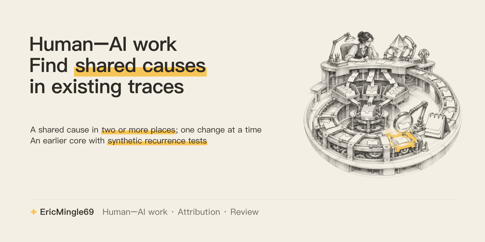
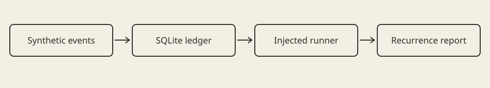

<picture>
  <source media="(prefers-color-scheme: dark)" srcset="readme-assets/cover-en-dark.png">
  
</picture>

<p align="center"><a href="docs/architecture.md">Architecture</a> · <a href="docs/research-roadmap.md">Research roadmap</a> · <a href="CONTRIBUTING.md">Contributing</a> · <a href="https://github.com/Ming-Sir-69">Author</a></p>

<p align="center">


<a href="https://github.com/Ming-Sir-69/astra-harness/actions/workflows/research-core.yml"></a>
</p>

<p align="center"><a href="README.md">简体中文</a> · <b>English</b></p>

# Astra Harness · Shared causes and recurrence in human–AI work

This project examines recurring corrections in human–AI work: group existing traces by shared cause, change one thing, then check recurrence. This repository provides the Python research core and synthetic experiments of an earlier per-correction logging approach; HCD scoring is no longer used in the current workflow.

## Main features

No extra logging; the workflow uses the traces that already exist:

1. **Gather existing traces**: commits, conversations, review comments.
2. **Group by shared cause**: only problems whose cause shows up in two or more places.
3. **Compare with what works well**: find the step where it falls short.
4. **Change one thing at a time**: small enough to tell whether it was that change.
5. **Look again later**: if the same kind of problem comes back, the change did not work.

<details>
<summary>Public capabilities and boundaries</summary>

| Capability | Public 0.1.2 | Boundary |
|---|---|---|
| HCD event protocol and SQLite ledger | Implemented | Explicit data root; bounded inputs; idempotency; ownership/epoch checks |
| Acceptance and ordinal distance | Implemented | Plan/result separate; evidence required; later corrections and expiry invalidate stale state |
| Pattern clustering and recurrence | Implemented | Caller-injected structured runner; no bundled model client or automatic scheduler |
| Schema 3 report | Implemented | Pattern recurrence is primary; D is secondary; coverage and user truth remain unknown |
| Student-label agreement | Protocol implemented | Optional caller-supplied labels; agreement with model clustering is not user-verified accuracy |
| Synthetic demo and regression suite | Included | Synthetic fixtures only; no network or inference |
| Native host collection, desktop capture, long-term memory service | Excluded | Private integration adapters and configuration are not distributed |
| Local model training, automatic maintenance, transactional live deployment | Excluded | This package cannot install or run these integrations |
| Cloud maintenance and MCP server | Contract lineage documented only | No cloud endpoint, credentials, authentication implementation, or server is included |

</details>

## Quick start

Python 3.11 or later on Linux/macOS is sufficient. Runtime code uses the standard library; POSIX file locks are required. Imports perform no host discovery, observation, training, scheduling, or networking.

From a source checkout:

```sh
PYTHONPATH=src python3 -B -m unittest discover -s tests -v
python3 -B scripts/publication_check.py check --root .
DEMO_ROOT="$(python3 -c 'import os,tempfile;print(os.path.realpath(tempfile.mkdtemp()))')"
PYTHONPATH=src python3 -B -m astra_harness demo --data-root "$DEMO_ROOT"
```

On macOS, `/var` and `/tmp` are symlinks. The core rejects symlink path components; the command above resolves its temporary directory first. `hcd.report` prunes evidence older than 90 days.

The demo requires an empty scratch directory and writes a **synthetic** ledger there. It registers initial directions and corrections for TaskA/TaskB, uses a deterministic injected runner to identify a common verification omission, marks a synthetic intervention, and shows recurrence after that intervention. The result retains `benefit: unknown` and `coverage: unknown`; no model or production information is used.

## Usage

For library use, call `hcd.record(event, data_root)` and `hcd.report(data_root)` with an explicitly selected research root. The caller supplies session and project identity. There is no ambient host-session fallback or automatic installation. The included example profile keeps all integrations disabled and cannot enable unbundled private capabilities.

## Design and principles

The HCD event protocol stores its ledger through the Python standard-library SQLite interface<sup>[[1]](#references)</sup>.

<picture>
<source media="(prefers-color-scheme: dark)" srcset="readme-assets/architecture-dark.svg">

</picture>

**Method change**: the earlier approach recorded each correction and then clustered the records by shared cause. Per-correction logging added work and missed entries; the current method analyses existing commits, conversations and reviews. Material coverage and operating cost have no quantitative comparison.

**Intervention awaiting review**: rework was attributed to task descriptions that omitted the intended audience and scope constraints. A three-line check was added before starting work. Follow-up criteria are defined; no intervention result is available.

The research core of the earlier approach (per-correction logging, cross-task clustering, checking for recurrence after an intervention). The `hcd` module in the code (Human Correction Distance) was the part that scored corrections at the time; the current workflow retains it only for reference. Only source code, synthetic examples and documentation are here — no real conversations, logs or task records.

## Limitations

Plan and result acceptance are separate. Later correction, self-correction, reopening, abandonment, goal change, or evidence expiry invalidates the relevant acceptance and scores. Weak acceptance is only an observational proxy, not explicit user acceptance.

Public tests establish specified engineering behavior. They do not establish reduced human correction, complete observation, model superiority, or a causal benefit.

## Development

- [Architecture and evidence boundaries](docs/architecture.md)
- [Evolution and version meanings](docs/evolution.md)
- [Concrete research roadmap](docs/research-roadmap.md)
- [Changelog](CHANGELOG.md)
- [Contribution and release process](CONTRIBUTING.md)
- [Public publication and maintenance](docs/PUBLICATION.md)
- [Personal authorship notice](PERSONAL-NOTICE.md)

[Engram](https://github.com/Ming-Sir-69/engram) is the knowledge base underneath this way of working, maintained separately; it is not bundled here.

Internal package `1.0.0` and MCP interface `1.0.3` are implementation lineage, not earlier public releases of this core. A new public version follows changes to the public implementation and documented research boundaries.

## Acknowledgements

The cover illustration was generated with an OpenAI image-generation model and processed by this project.

Acknowledgements to the Python and SQLite open-source projects for the runtime and ledger storage.<sup>[[1]](#references)</sup>

## References

1. Python Software Foundation. *Python 3.11 documentation: sqlite3 — DB-API 2.0 interface for SQLite databases*. https://docs.python.org/3.11/library/sqlite3.html

## Repository structure

| Path | Contents |
|---|---|
| `src/astra_harness/` | HCD, patterns, storage, safety |
| `tests/` | Synthetic regressions |
| `docs/` | Architecture, evolution, publication |
| `examples/` | Disabled integration profile |
| `scripts/` | Publication boundary check |
| `readme-assets/` | Light/dark covers |

---

Maintained by **✦ EricMingle69** · [Ming-Sir-69](https://github.com/Ming-Sir-69)  
Code, text and original graphics are released under the [MIT License](LICENSE).
