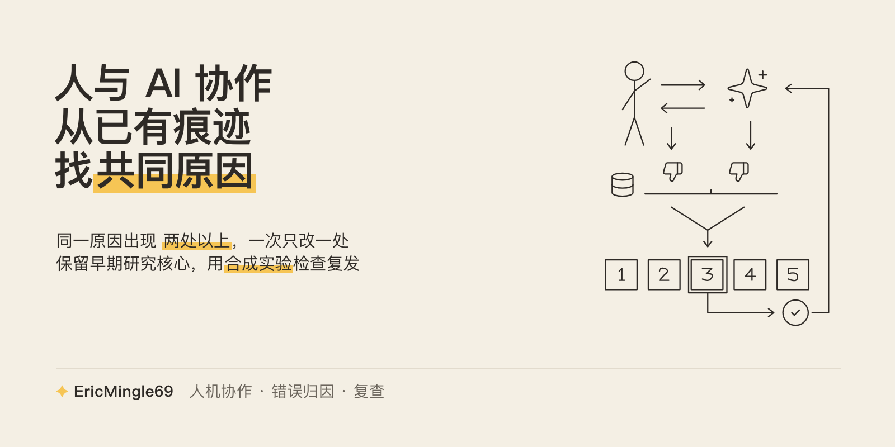
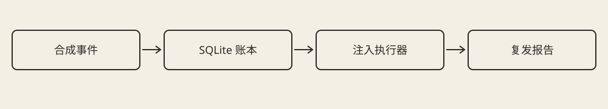

<picture>
  <source media="(prefers-color-scheme: dark)" srcset="readme-assets/cover-zh-dark.png">
  
</picture>

<p align="center"><a href="docs/architecture.md">架构</a> · <a href="docs/research-roadmap.md">研究路线</a> · <a href="CONTRIBUTING.md">贡献</a> · <a href="https://github.com/Ming-Sir-69">作者主页</a></p>

<p align="center">


<a href="https://github.com/Ming-Sir-69/astra-harness/actions/workflows/research-core.yml"></a>
</p>

<p align="center"><b>简体中文</b> · <a href="README.en.md">English</a></p>

# Astra Harness · 人与 AI 协作中的共同原因与复发检查

本项目整理人与 AI 协作中的反复纠偏问题：从已有痕迹归并共同原因，一次改一处，再检查复发。本仓库提供早期逐次登记方案的 Python 研究核心与合成实验；当前工作方式不再使用 HCD 评分。

## 主要功能

不额外登记，直接用平时就留下的痕迹：

1. **汇集已有痕迹**：提交记录、对话原文、评审意见，本来就在。
2. **归并共同原因**：只看同一个原因在两处以上出现的问题，一次性的不追。
3. **对照做得好的做法**：找出差在哪一步。
4. **一次只改一处**：改动小，才看得出是不是这处起了作用。
5. **回头看是否再犯**：过几天看同类问题还出不出现，出现就说明没改对。

<details>
<summary>公开能力与边界</summary>

| 能力 | 公共 0.1.2 | 边界 |
|---|---|---|
| HCD 事件协议与 SQLite 账本 | 已实现 | 显式数据根、输入限额、幂等、owner/epoch 检查 |
| 接受状态与序数距离 | 已实现 | 方案/成品分开；需证据；后续纠偏和过期使旧状态失效 |
| 模式聚类与复发 | 已实现 | 调用方注入结构化 runner；无内置模型客户端或调度器 |
| Schema 3 报告 | 已实现 | 模式复发为主，D 为次要；任务覆盖与用户真值保持未知 |
| 学生标签一致率 | 协议已实现 | 可选外部标签；与模型聚类一致不等于用户确认的准确率 |
| 合成演示与回归测试 | 已提供 | 只用合成输入，无网络或推理 |
| 原生宿主采集、桌面捕获、长期知识服务 | 未包含 | 不分发私有集成适配器和配置 |
| 本地模型训练、自动维护、生产事务部署 | 未包含 | 本包不能安装或运行这些集成 |
| 云端维护与 MCP 服务 | 仅说明合同谱系 | 不含云端地址、凭据、认证实现或服务器 |

</details>

## 快速开始

支持 Linux/macOS，要求 Python 3.11 或以上及 POSIX 文件锁；运行源码仅依赖标准库。导入模块不会发现宿主、启动观察、训练、调度或网络连接。

在源码目录执行：

```sh
PYTHONPATH=src python3 -B -m unittest discover -s tests -v
python3 -B scripts/publication_check.py check --root .
DEMO_ROOT="$(python3 -c 'import os,tempfile;print(os.path.realpath(tempfile.mkdtemp()))')"
PYTHONPATH=src python3 -B -m astra_harness demo --data-root "$DEMO_ROOT"
```

macOS 的 `/var`、`/tmp` 是软链接；核心拒绝软链接路径组件，上面的命令会先解析临时目录。`hcd.report` 会清理超过 90 天的证据。

演示要求空白临时目录，只在其中生成**纯合成**账本：登记 TaskA/TaskB 的初始方向与纠偏，用确定性的注入 runner 找到共同的输出核验缺失模式，标记一次合成干预，再观察该模式复发。输出保留 `benefit: unknown`、`coverage: unknown`，不用模型或生产信息。

## 用法

作为库使用时，调用 `hcd.record(event, data_root)` 和 `hcd.report(data_root)`，由调用方显式指定研究数据根、会话和项目身份。没有宿主会话环境变量兜底或自动安装。示例 profile 默认关闭全部集成，不能启用公共包没有提供的私有能力。

## 设计与原理

HCD 事件协议使用 Python 标准库的 SQLite 接口保存账本<sup>[[1]](#参考文献)</sup>。

<picture>
<source media="(prefers-color-scheme: dark)" srcset="readme-assets/architecture-zh-dark.svg">

</picture>

**方法变化**：早期方案逐次登记纠正，再聚类寻找共同原因。逐次登记存在额外操作负担与漏记问题；当前方法直接分析已有提交、对话与评审痕迹。材料覆盖与操作成本尚无量化对照。

**待复查的干预**：已有返工被归因于任务说明缺少使用对象与范围约束，因此在开工前增加三行确认。复查标准已设定，尚无干预结果。

这里放的是早期做法（逐次登记纠正、跨任务聚类、看干预后是否复发）的研究核心。代码里的 `hcd` 模块（Human Correction Distance，纠偏距离）是当时用来衡量纠正程度的部分，当前工作方式已不再使用它，留作参考。仓库只含源码、从零合成的示例和文档，没有任何真实对话、日志或任务记录。

## 局限

方案接受与成品接受分别记录；后续纠偏、自主修正、重开、放弃、目标变化或证据过期会使相关接受与评分失效。弱接受仅是观察代理信号，不能当成用户明确验收。

合成测试验证确定的工程行为，不能据此判断降低真实纠偏、完整观察、模型优越性或因果收益。学生标签与模型聚类的一致率也不是用户真值。

## 开发

- [架构与证据边界](docs/architecture.md)
- [版本演化与编号含义](docs/evolution.md)
- [具体研究路线](docs/research-roadmap.md)
- [更新记录](CHANGELOG.md)
- [贡献与发布流程](CONTRIBUTING.md)
- [公开发布与持续维护](docs/PUBLICATION.md)
- [个人作者说明](PERSONAL-NOTICE.md)

[Engram](https://github.com/Ming-Sir-69/engram) 是这套做法底下的知识库，独立维护；本仓库不内置它。

## 致谢

封面图标沿用 Lucide 几何，许可见 [图标许可](readme-assets/LUCIDE-LICENSE.txt)。

感谢 Python 与 SQLite 开源项目提供运行环境及账本存储基础。<sup>[[1]](#参考文献)</sup>

## 参考文献

1. Python Software Foundation. *Python 3.11 documentation: sqlite3 — DB-API 2.0 interface for SQLite databases*. https://docs.python.org/3.11/library/sqlite3.html

## 仓库结构

| Path | 内容 |
|---|---|
| `src/astra_harness/` | HCD, patterns, storage, safety |
| `tests/` | Synthetic regressions |
| `docs/` | Architecture, evolution, publication |
| `examples/` | Disabled integration profile |
| `scripts/` | Publication boundary check |
| `readme-assets/` | Light/dark covers |

---

文档维护：**✦ EricMingle69** · [Ming-Sir-69](https://github.com/Ming-Sir-69)  
代码、文字与自有图形以 [MIT 许可](LICENSE) 发布；Lucide 图标沿用 [ISC 许可](readme-assets/LUCIDE-LICENSE.txt)。
