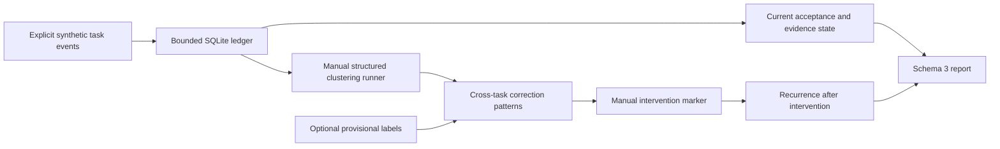

# Architecture and evidence boundaries

The public core separates **recorded events**, **derived state**, **model labels**, and **intervention hypotheses**. It provides a reproducible correction-research protocol rather than a second memory service or an agent-control framework.

## Event ledger

`hcd.record(event, root)` requires a caller-supplied root, session, project path, stable task name, event kind, and idempotency request key. Project paths are validated and hashed; no project files are opened. Session identity does not come from host environment variables. Only the main task owner can register task state; explicit handoff changes owner and epoch while preserving the first anchor.

The first direction is immutable and cannot be reconstructed after later events. A repeated request with identical content is a duplicate; reusing its key with different content is rejected. Input summaries and evidence fields have byte limits and credential-like field rejection. SQLite uses a fixed 8 MiB database ceiling, DELETE journaling, bounded lock acquisition, and 90-day event retention. These are engineering resource bounds, not claims of anonymous data or comprehensive secret detection.

Acceptance of a plan and acceptance of a result are separate. An acceptance event requires evidence; a host Stop is not acceptance. Ordinal D estimates are recorded only against a current accepted endpoint and an available first anchor. Correction, self-correction, reopening, abandonment, or goal change invalidates current acceptance, D, and quality state. Expired evidence cannot justify a fresh score. Human correction and agent self-correction remain separate signals.

## Patterns and recurrence

`patterns.cluster(root, runner)` calls only the runner explicitly supplied by the caller. The package provides no model client, network transport, billing integration, or scheduler. The runner receives at most 200 retained correction/reopening observations and must return the declared structured schema. Each supported pattern needs at least two distinct existing members; invented or duplicated members do not create support.

A maintenance hypothesis requires support across at least two tasks and an actionable entry, skill, or tool target. A project-specific suggestion remains project-specific. `patterns.adopt` records a **manual research intervention marker**; it does not modify an agent, a skill, a tool, or host configuration. Its recurrence statistics expose task count, recent count, provisional count, and observations after the marker. Temporal ordering alone does not establish that an intervention caused an improvement or failure.

Optional provisional student labels are supplied by the caller. At the next clustering, `student_agreement` compares them with clustering labels. Both may be model judgments based on agent-relayed evidence; their agreement is not user-confirmed correctness. No student model, weights, adapter, training data, or training runner is included.

## Reporting

`hcd.report(root)` prunes expired evidence and writes one bounded report. Schema 3 leads with cross-task pattern recurrence; D remains secondary. The report keeps `actual_task_coverage: unknown` and identifies semantic labels as agent-reported rather than independently verified user truth.

The first-pass proxy considers tasks with a first anchor that have been idle at least one day and have no recorded correction. Weak acceptance means an idle task was not reopened or abandoned; it is kept separate from explicit acceptance. Missing observations, differing task difficulty, and changes in user behavior can bias these proxies. Empty adapter fields in this core show that no adapter is included, not that no outside activity occurred.

## Local filesystem boundary

The core rejects credential-class paths and existing symlink components before I/O. State paths are supplied explicitly; imports perform no writes. These checks reduce accidental access but are not an OS sandbox or authorization service. Callers should use a dedicated scratch directory and their own appropriate process permissions. No arbitrary command, shell, remote execution, cloud publish, or live deployment interface exists in this distribution.

The disabled example profile describes excluded integrations; changing it cannot enable observation, training, automatic maintenance, or cloud access. Native collection, desktop capture, memory-service connections, authentication, and maintenance/deployment adapters remain outside the public distribution.

[Engram](https://github.com/Ming-Sir-69/engram) maintains long-term knowledge in a separate project. HCD's evaluation ledger is retention-bounded operational evidence, not an alternative long-term memory store. This public core does not ship that connection.

## Public/private publication boundary

Only the declared source, documentation, synthetic tests, and example profile belong to a release. Actual records—including anonymized records—never belong to this repository. Public release checks use an explicit file allowlist, reject nested repositories and symlinks, and reject operational data file types and personal endpoint/path patterns. Review remains required: a scanner cannot prove that arbitrary prose or code contains no private fact.
